 

  

 

## 01 / About Me — Sobre mí

**ESPAÑOL**

Soy Lizbeth Estrada, conocida como Liz. Soy Técnica Programadora y actualmente continúo mi formación en el área de Sistemas.

Me interesa comprender los problemas desde distintas perspectivas y convertir necesidades reales en soluciones tecnológicas. He trabajado en proyectos de chatbots con inteligencia artificial, desarrollo web, programación, bases de datos, análisis de documentos e investigación de problemáticas reales.

Me adapto a diferentes tecnologías y roles dentro de un proyecto. Actualmente sigo fortaleciendo mis habilidades, explorando nuevas herramientas y aprendiendo a construir software cada vez más útil, estructurado y accesible.

**ENGLISH**

I'm Lizbeth Estrada, also known as Liz. I'm a Programming Technician currently continuing my education in Systems.

I'm interested in understanding problems from different perspectives and turning real-world needs into technological solutions. I've worked on AI-powered chatbot projects, web development, programming, databases, document analysis, and research into real-world challenges.

I'm adaptable to different technologies and project roles. I'm continuously developing my skills, exploring new tools, and learning to build increasingly useful, well-structured, and accessible software.

 

## 02 / Tech Stack

<table>
  <tr>
    <td align="center"></td>
    <td align="center"></td>
    <td align="center"></td>
    <td align="center"></td>
  </tr>
  <tr>
    <td align="center"></td>
    <td align="center"></td>
    <td align="center"></td>
    <td></td>
  </tr>
</table>

**Areas of interest**
- Frontend and backend development
- Artificial intelligence and chatbot development
- Databases and information management
- Document analysis, data analysis, and research
- Software development focused on real-world needs

 

## 03 / Currently Learning

- C# and the .NET ecosystem
- Software architecture and application development
- Code quality, debugging, and problem-solving
- New technologies and development workflows

 

## 04 / Projects with Purpose

I believe software should do more than work: it should address meaningful problems.

My academic and personal projects explore ways to use programming, research, and technology to understand real needs and create solutions that can help people.

Creo que el software debe hacer más que funcionar: debe responder a problemas importantes. Mis proyectos académicos y personales buscan combinar programación, investigación y tecnología para comprender necesidades reales y crear soluciones útiles.

 

## 05 / My Philosophy

*"No nací sabiendo crear tecnología, nací con curiosidad por descubrir hasta dónde puedo llegar."*

**Learn continuously. Adapt confidently. Create with purpose.**

 

